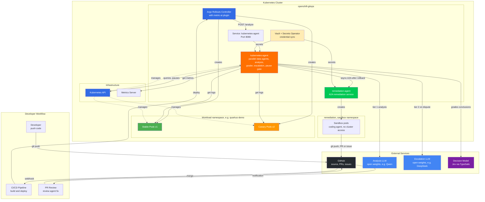
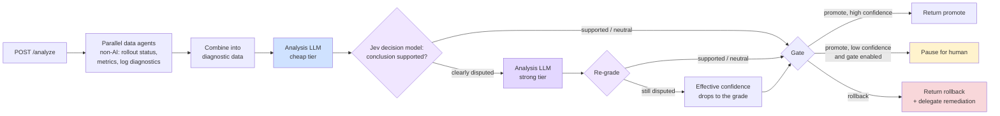

## Canary Analysis Process Flow

This diagram shows the complete flow from canary deployment through tiered AI analysis to automated PR creation:

```mermaid
flowchart TD
    Start([Argo Rollouts Canary Deployment]) --> Canary[Deploy Canary v2<br/>alongside Stable v1]
    Canary --> Traffic[Route Traffic<br/>10% to Canary<br/>90% to Stable]
    Traffic --> Analysis[Argo Rollouts Analysis<br/>runs Analysis Template]
    
    Analysis --> Plugin{Metric AI Plugin<br/>argoproj-labs/metric-ai}
    
    Plugin --> AgentCall[Single HTTP call:<br/>POST /analyze<br/>with pod selectors]
    
    AgentCall --> K8sAgent[Kubernetes AI Agent<br/>in cluster]
    
    K8sAgent --> AgentTools[Agent gathers evidence in parallel:<br/>rollout status ∥ canary metrics ∥<br/>pod logs and events]
    
    AgentTools --> CheapModel[Analysis tier 1:<br/>cheap LLM concludes<br/>promote or rollback]
    
    CheapModel --> Grader{Decision model grades:<br/>is the conclusion<br/>supported by the evidence?}
    
    Grader -->|Supported or neutral| Gate
    Grader -->|Clearly disputed| StrongModel[Analysis tier 2:<br/>stronger LLM re-analyzes<br/>the same evidence]
    StrongModel --> Gate{Promote with low<br/>effective confidence<br/>and gate enabled?}
    
    Gate -->|Yes| Pause[Pause rollout<br/>for human review]
    Gate -->|No| NeedsFix{Rollback with<br/>a repo configured?}
    
    NeedsFix -->|Yes| Delegate[Delegate remediation over A2A<br/>runs in the background]
    NeedsFix -->|No| Response
    
    Delegate --> Remediation[Remediation agent sandbox:<br/>fix, verify with tests,<br/>open PR or issue]
    Remediation --> PRLink[PR / issue link<br/>published via activity events]
    PRLink --> Response
    
    Response[Return Analysis Response:<br/>- Root Cause<br/>- Promote Decision<br/>- Confidence Level]
    
    Response --> PluginDecision{Plugin Decision}
    
    PluginDecision -->|Promote| Promote[Promote Canary<br/>to 100%]
    PluginDecision -->|Abort| Abort[Abort Rollout<br/>Rollback to Stable]
    
    Promote --> Complete([Deployment Complete])
    Abort --> Complete
    Pause --> Human[Human reviews<br/>promote or abort]
    Human --> Promote
    Human --> Abort
    
    style Start fill:#e1f5e1
    style Complete fill:#e1f5e1
    style K8sAgent fill:#fff3cd
    style Plugin fill:#d1ecf1
    style Grader fill:#f0e6ff
    style StrongModel fill:#f0e6ff
    style Delegate fill:#f8d7da
    style Remediation fill:#f8d7da
    style PRLink fill:#d4edda
    style AgentTools fill:#cfe2ff
```

## System Architecture

This diagram shows all the components, services, and their interactions:

## Analysis pipeline detail

Inside the kubernetes-agent, one analysis request runs this pipeline:

